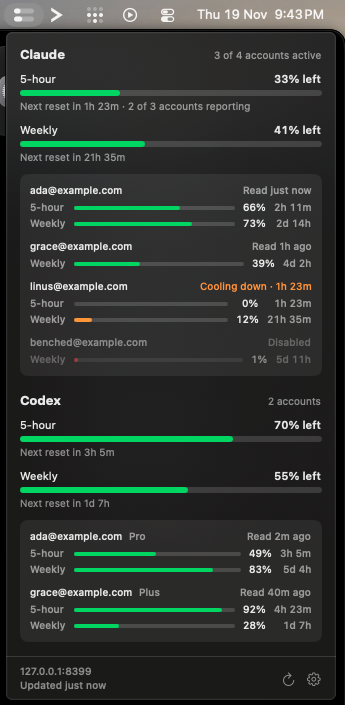

# api-proxy-widget

A macOS menu bar widget that shows how much of your Claude and Codex limits is left across every account on a [CLIProxyAPI](https://github.com/router-for-me/CLIProxyAPI) hub.

It is for people who run the [one hub, many accounts](https://gist.github.com/t3dotgg/59a521d2ee8d70aaf90e280c175072af) setup and want the pooled limits one glance away instead of on the hub's quota page.



The screenshot shows made-up accounts from `make demo-hub`.

## What you see

The menu bar item is two gauges. The top one is the pooled 5-hour window and the bottom one is the pooled weekly window. Both drain as the pool is used. If the hub has Claude accounts the gauges show Claude, otherwise Codex. A warning sign replaces them when the hub rejects the key or has not answered for five minutes.

Click it for the panel:

- Per provider, each limit window averaged over the accounts that report it, with the soonest reset.
- Each account with its own windows, how long ago the hub read them, and whether the account is cooling down or disabled.

A pooled number is the average share left over the accounts that report that window, the same rule the hub's quota page uses. An account that reports no 5-hour window is left out of the 5-hour average instead of counted as full. Disabled accounts are listed but never averaged.

## Install

You need macOS 14 or later and Xcode 16 or later (for Swift 6).

```sh
git clone https://github.com/StivenKN/api-proxy-widget.git
cd api-proxy-widget
make install
```

`make install` builds the app, copies it to `/Applications/API Proxy Widget.app` and starts it. Run it again after `git pull` to update. There is no signed download yet, so building it yourself is the only way to install.

## Connect your hub

The first click on the menu bar item asks for two things:

- **Hub address.** `http://127.0.0.1:8317` on the hub itself, or the tailnet address such as `https://hub.example.ts.net:8317` from another Mac.
- **Management key.** The plain text of `management.secret-key` from the hub's config. This is not the access key your tools send. The hub's config file only holds a hash of it, so use the value you chose when you set the hub up. The hub must have a management key set, and `management.allow-remote: true` if the widget runs on another machine.

Tick "Open at login" in the same panel to keep the widget in the menu bar after a restart.

## How it reads limits

CLIProxyAPI keeps the rate-limit headers of each account's latest response from the provider: `anthropic-ratelimit-unified-*` for Claude and `x-codex-*` for Codex. It returns them as `quota.signals` on `GET /v0/management/auth-files`. The widget asks for that list once a minute, and again when you open the panel.

Reading it sends nothing to Anthropic or OpenAI. The hub answers from memory, so the widget does not spend the usage endpoint's own rate limit or add traffic to your accounts.

Because the hub learns limits from traffic, a few things follow:

- An idle account keeps its last reading. Each account row says how old its reading is.
- When a window's reset time passes, the widget counts that window as full again without waiting for a new reading.
- After the hub restarts, an account shows "No data yet" until it serves a request.

## The management key

The management key can change the hub's config and download its account logins, so the widget handles it with some care:

- It stores the key in your login keychain through `/usr/bin/security`, filed under the hub's address. A different hub address never receives the first hub's key. The widget uses Apple's tool, as `gh` does, because a keychain item only opens without a password prompt for the program that created it, and every rebuild of an unsigned app counts as a new program. The cost is that other programs running as you can read the item the same way.
- CLIProxyAPI bans an address from the management API for 30 minutes after five wrong keys. When the hub rejects the key, the widget stops asking until you save a new one.
- A hub address typed without `http://` or `https://` gets HTTPS unless it is on this Mac.

## Try it without a hub

```sh
make demo-hub
```

This serves made-up accounts on `http://127.0.0.1:8399` with the management key `demo`. Save those two values in the widget's settings.

## Development

```sh
swift test       # parser, pooling and hub client tests
make app         # build/API Proxy Widget.app
```

`Sources/ProxyLimits` reads and pools limits and has no UI. `Sources/APIProxyWidget` is the SwiftUI menu bar app.

## What it does not do yet

- It reads Claude and Codex accounts only. Other providers on the hub are ignored.
- Codex support is built from the header shapes in CLIProxyAPI's own tests. It has not been checked against a live Codex account.
- It shows the 5-hour, weekly and model-scoped windows the provider puts in response headers. Extra usage credits are not shown.

## License

MIT. Created in [T3 Code](https://t3.codes).
